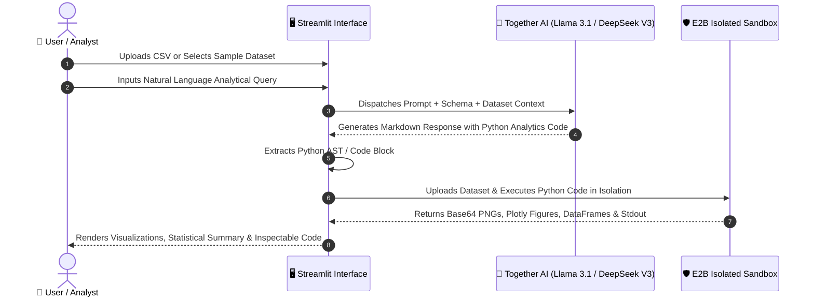

# 📊 AI Data Visualization Agent

[](https://www.python.org/)
[](https://streamlit.io/)
[](https://www.together.ai/)
[](https://e2b.dev/)
[](LICENSE)
[](CONTRIBUTING.md)

An autonomous, full-stack **Data Science and Visualization Agent** that converts natural language business queries into verified Python analytical code, executes it inside secure, isolated cloud sandboxes, and dynamically renders publication-ready charts and statistical reports.

---

## 🌟 Executive Summary & Architecture

Traditional data analysis requires manual SQL queries, Python data-wrangling scripts, and iterative charting in notebooks. The **AI Data Visualization Agent** bridges this gap by orchestrating cutting-edge Open-Source LLMs (**Meta-Llama 3.1 405B**, **DeepSeek V3**, **Llama 3.3 70B**, and **Qwen 2.5**) with **E2B's isolated cloud sandbox environment**.

### System Architecture Flow



---

## ✨ Key Features

- **🗣️ Natural Language to Analytics**: Ask questions in plain English (*"Compare gross profit margins across product lines by city"*), and the agent handles data cleaning, aggregation, and plotting.
- **🛡️ Zero-Trust Cloud Sandboxing**: Generated code runs completely inside remote, ephemeral **E2B sandboxes**, eliminating risks of local code execution and library dependency conflicts.
- **🧠 Multi-Model LLM Backbone**: Dynamically toggle between frontier open-weight models via Together AI:
  - **Meta-Llama 3.1 405B Instruct** (Flagship reasoning & complex multi-step analysis)
  - **DeepSeek V3** (State-of-the-art coding and data transformations)
  - **Meta-Llama 3.3 70B Instruct** (High-throughput, balanced speed & accuracy)
  - **Qwen 2.5 7B Instruct** (Fast lightweight iterations)
- **📈 Multi-Format Visualization Engine**: Automatically parses and renders **Matplotlib figures**, **Seaborn charts**, **Plotly interactive plots**, and tabular summaries.
- **📁 Built-in Sample Dataset**: Includes a 150-row Supermarket Retail Sales dataset with one-click prompt presets for instant testing.
- **🔍 Full Code Transparency**: An expandable code viewer lets users audit the exact Python code generated and executed for every query.

---

## 🛠️ Tech Stack

| Component | Technology | Purpose |
| :--- | :--- | :--- |
| **User Interface** | [Streamlit](https://streamlit.io/) | Interactive, responsive analytics dashboard |
| **LLM Inference** | [Together AI](https://api.together.ai) | Cloud inference for Llama 3.1 405B, DeepSeek V3, Qwen 2.5 |
| **Execution Sandbox** | [E2B Code Interpreter](https://e2b.dev) | Isolated, secure cloud environment for running Python |
| **Data Processing** | [Pandas](https://pandas.pydata.org/), [NumPy](https://numpy.org/) | Data wrangling, aggregation, and mathematical modeling |
| **Visualization** | [Matplotlib](https://matplotlib.org/), [Seaborn](https://seaborn.pydata.org/), [Plotly](https://plotly.com/) | Statistical graphics and publication-ready charts |
| **Environment Mgmt** | `python-dotenv` | Clean secret and configuration handling |

---

## 🚀 Quickstart Guide

### 1. Prerequisites

- Python 3.10, 3.11, or 3.12
- [Together AI API Key](https://api.together.ai/signin) (Free $1 credit upon sign-up)
- [E2B API Key](https://e2b.dev) (Free tier available)

### 2. Clone Repository

```bash
git clone https://github.com/Vaibhav1376/ai-data-visualization-agent.git
cd ai-data-visualization-agent
```

### 3. Create & Activate Virtual Environment

```bash
# Windows
python -m venv venv
.\venv\Scripts\activate

# macOS / Linux
python3 -m venv venv
source venv/bin/activate
```

### 4. Install Dependencies

```bash
pip install --upgrade pip
pip install -r requirements.txt
```

### 5. Configure API Credentials (Optional)

Create a `.env` file in the root directory (or enter keys directly via the Streamlit sidebar):

```env
TOGETHER_API_KEY=your_together_api_key_here
E2B_API_KEY=your_e2b_api_key_here
```

### 6. Run the Application

```bash
streamlit run app.py
```

The application will launch in your browser at `http://localhost:8501`.

---

## 💡 Example Analytical Queries

Try these sample queries using the included retail dataset:

| Category | Example Query | Generated Visualization |
| :--- | :--- | :--- |
| **Revenue Analysis** | *"Which product line generates the highest gross income? Plot a sorted bar chart with annotations."* | Horizontal Bar Chart with monetary labels |
| **Customer Profiling** | *"Compare average spending and purchase quantity between Members and Normal customers."* | Grouped Bar Chart with mean values |
| **Time-Series Trends** | *"Plot the daily total sales trend across the 3-month period with a 7-day moving average."* | Dual-axis Line Plot |
| **Correlation & Ratings** | *"Is there a correlation between customer ratings and total invoice spend? Show a scatter plot colored by customer gender."* | Scatter Plot with regression trendline |

---

## 📂 Repository Structure

```text
ai-data-visualization-agent/
├── .github/
│   └── workflows/
│       └── ci.yml               # Automated CI workflow for syntax & test validation
├── data/
│   └── sample_sales_data.csv    # Supermarket retail sales demo dataset (150 rows)
├── .env.example                 # Environment variables configuration template
├── .gitignore                   # Comprehensive Python & Streamlit ignore rules
├── ai_data_visualisation_agent.py # Core agent logic, LLM calling & sandbox integration
├── app.py                       # Application entrypoint
├── LICENSE                      # MIT Open Source License
├── README.md                    # Project documentation & resume guide
└── requirements.txt             # Pinned project dependencies
```

---

## 💼 Resume & Portfolio Highlights

If you are featuring this project on your resume, LinkedIn, or portfolio, here are suggested bullet points tailored for **AI Engineer**, **Data Scientist**, and **Full-Stack Developer** roles:

> - **Architected an Autonomous Data Visualization Agent** leveraging open-source LLMs (Meta-Llama 3.1 405B, DeepSeek V3) to synthesize complex natural language queries into executable Pandas and Matplotlib analytics scripts.
> - **Eliminated Untrusted Code Execution Risks** by integrating E2B's isolated cloud sandboxes, enabling safe real-time execution of dynamic Python code without host vulnerability.
> - **Engineered an Interactive Streamlit Interface** featuring multi-model selection, dataset profiling, and dynamic rendering for both static (Matplotlib/Seaborn) and interactive (Plotly) visual outputs.
> - **Implemented CI/CD Automation** with GitHub Actions for automated syntax validation and dependency checks across Python environments.

---

## 🤝 Contributing

Contributions are welcome! Please feel free to open an issue or submit a Pull Request.

1. Fork the repository
2. Create your feature branch (`git checkout -b feature/AmazingFeature`)
3. Commit your changes (`git commit -m 'feat: Add some AmazingFeature'`)
4. Push to the branch (`git push origin feature/AmazingFeature`)
5. Open a Pull Request

---

## 📄 License

This project is licensed under the MIT License - see the [LICENSE](LICENSE) file for details.

---

## 👨‍💻 Author

**Vaibhav Kakad**
- GitHub: [@Vaibhav1376](https://github.com/Vaibhav1376)
- Email: vaibhavkakad76@gmail.com
